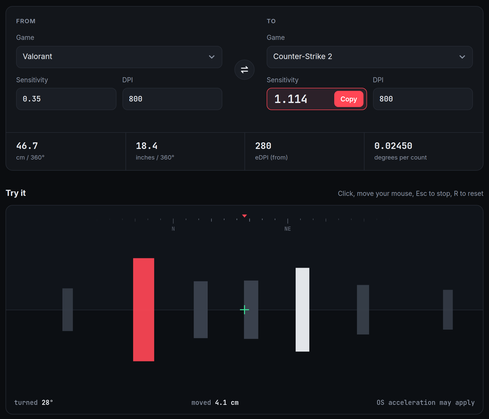

# sens

Mouse sensitivity converter for games. Pick the game you play and the one you're switching to, and it gives you the sensitivity that turns the same distance per cm of mouse movement. You can also try the new sensitivity in a 3D view before opening the game.

**https://salw2e.github.io/sens**

To run it locally, open `index.html` in a browser.

Games: Counter-Strike 2, Valorant, Apex Legends, Overwatch 2, Call of Duty, Fortnite, Rainbow Six Siege, Deadlock, Destiny 2, Minecraft, Team Fortress 2, CS:GO, Titanfall 2, Quake Champions, Quake Live, Half-Life 2, Left 4 Dead 2, Garry's Mod.

The yaw values (degrees turned per mouse count at sensitivity 1) are only included where at least two sources agree. Minecraft uses the game's own curve, `1.2 * (0.6s + 0.2)^3`.

Links like `?from=cs2&sens=1.2&dpi=800&to=valorant` open with those values filled in.

Missing: Roblox, PUBG, Marvel Rivals, The Finals (sources disagree), ADS and FOV matching
